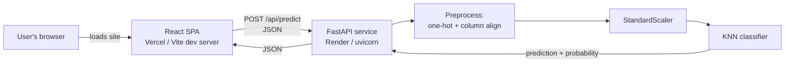

<div align="center">

# ❤️ HeartSense

**An end-to-end machine-learning web app that estimates heart disease risk from 11 clinical inputs.**


</div>

> ⚠️ **Medical disclaimer** — HeartSense is an educational project. It is a screening aid built on a small public
> dataset and is **not** a medical device or a diagnosis. Always consult a qualified clinician.

<!-- Add after deploying:  **Live demo:** https://your-app.vercel.app -->

---

## Table of contents
1. [Overview](#overview)
2. [Features](#features)
3. [Architecture](#architecture)
4. [Tech stack](#tech-stack)
5. [Project structure](#project-structure)
6. [Dataset](#dataset)
7. [Machine-learning pipeline](#machine-learning-pipeline)
8. [Getting started](#getting-started)
9. [Configuration](#configuration)
10. [API reference](#api-reference)
11. [Frontend](#frontend)
12. [Deployment](#deployment)
13. [Troubleshooting](#troubleshooting)
14. [Known limitations](#known-limitations)
15. [Roadmap](#roadmap)
16. [Acknowledgements](#acknowledgements)

---

## Overview
HeartSense takes eleven everyday clinical measurements (age, blood pressure, cholesterol, ECG findings, …),
sends them to a FastAPI service, and returns a **High / Low risk** verdict together with a risk score.
The prediction comes from a **K-Nearest-Neighbours** classifier trained in a Jupyter notebook; the React interface
is a polished, responsive front-end with a landing page and a guided input form. There are no accounts and no
database — nothing the user enters is stored.

## Features
- 🏠 **Landing page** introducing the app, its features and how it works
- 📝 **Guided input form** with sliders, unit-labelled fields and plain-language descriptions of medical abbreviations
- ⚡ **Instant prediction** — High/Low verdict plus an animated risk-score ring
- ✅ **Validation on both sides** — inline range checks in the UI, strict schema validation (Pydantic) in the API
- 🔒 **Stateless & private** — no authentication, no database, no logging of patient inputs by the app
- 📱 **Responsive dark UI** built with Tailwind CSS (glassmorphism, subtle animation)
- 🐳 **Container-ready** API image; split deployment (Render + Vercel) supported out of the box

## Architecture



**Request flow**
1. The React form posts the 11 fields as JSON to `/api/predict`.
2. FastAPI validates types and ranges (`422` on bad input).
3. Categorical fields are one-hot encoded into the **same 15 columns** used in training (`columns.pkl`); any column
   not present is filled with `0` and the order is enforced.
4. The saved `StandardScaler` scales the vector, then the saved `KNeighborsClassifier` predicts the class and the
   class probability.
5. The response `{ prediction, probability }` is rendered as the verdict and risk ring.

In development, Vite proxies `/api` to `localhost:8000`. In production the frontend calls the API URL given by
`VITE_API_URL` (CORS is restricted to the origins you configure).

## Tech stack

| Layer | Technology | Purpose |
|---|---|---|
| **Frontend** | React 19, React Router 7 | UI, client-side routing (`/`, `/check`) |
| | Vite 8 | Dev server, bundling, `/api` proxy |
| | Tailwind CSS 4 (`@tailwindcss/vite`) | Utility-first styling, design tokens, animation |
| | oxlint | Linting |
| **Backend** | FastAPI + Uvicorn | REST API, automatic OpenAPI docs |
| | Pydantic v2 | Request validation / typed schema |
| | pandas, joblib | Feature assembly, loading serialized artifacts |
| **ML** | scikit-learn 1.6.1 | `KNeighborsClassifier`, `StandardScaler` |
| | Jupyter, matplotlib, seaborn | EDA and model comparison (`ml/HeartDisease.ipynb`) |
| **DevOps** | Docker | API container image |
| | Render | Hosts the API (Docker web service) |
| | Vercel | Hosts the static React frontend |

> `scikit-learn` is pinned to **1.6.1** because that is the version the `.pkl` files were serialized with. Loading
> them with a different version works but emits an `InconsistentVersionWarning`.

## Project structure
```
Heart-Disease-Prediction/
├── ml/                          # Everything related to the model
│   ├── HeartDisease.ipynb       #   EDA, preprocessing, training, model comparison, export
│   ├── heart.csv                #   Dataset (918 rows × 12 columns)
│   ├── KNN_heart.pkl            #   Trained KNeighborsClassifier
│   ├── scaler.pkl               #   Fitted StandardScaler
│   └── columns.pkl              #   Ordered list of the 15 model input columns
│
├── backend/
│   ├── main.py                  # FastAPI app: /api/health, /api/predict (+ optional static serving)
│   └── requirements.txt
│
├── frontend/
│   ├── src/
│   │   ├── App.jsx              # Router (/ and /check)
│   │   ├── pages/
│   │   │   ├── Landing.jsx      # Marketing / landing page
│   │   │   └── Checker.jsx      # Input form + prediction call
│   │   └── components/
│   │       ├── fields.jsx       # Card, Slider, NumberInput, Segmented controls
│   │       └── Result.jsx       # Loading / error / result states, risk ring
│   ├── vercel.json              # SPA rewrite so /check works on refresh
│   ├── .env.example
│   └── vite.config.js           # React + Tailwind plugins, /api dev proxy
│
├── Dockerfile                   # API-only image
├── .dockerignore / .gitignore
├── render.yaml                  # Optional Render blueprint
└── README.md
```

## Dataset
`ml/heart.csv` — 918 patient records, 11 features and a binary target. It has no missing values and no duplicate
rows (the notebook checks both), although `RestingBP` and `Cholesterol` contain `0` placeholders (see
[preprocessing](#preprocessing)). The structure matches the public *Heart Failure Prediction* dataset.

| Feature | Type | Description |
|---|---|---|
| `Age` | int | Age in years |
| `Sex` | categorical | `M` / `F` |
| `ChestPainType` | categorical | `TA` typical angina · `ATA` atypical angina · `NAP` non-anginal pain · `ASY` asymptomatic |
| `RestingBP` | int | Resting blood pressure (mm Hg) |
| `Cholesterol` | int | Serum cholesterol (mg/dL) |
| `FastingBS` | binary | `1` if fasting blood sugar > 120 mg/dL, else `0` |
| `RestingECG` | categorical | `Normal` · `ST` (ST-T wave abnormality) · `LVH` (left ventricular hypertrophy) |
| `MaxHR` | int | Maximum heart rate achieved (bpm) |
| `ExerciseAngina` | binary | Exercise-induced angina — `Y` / `N` |
| `Oldpeak` | float | ST depression induced by exercise relative to rest |
| `ST_Slope` | categorical | Slope of the peak-exercise ST segment — `Up` · `Flat` · `Down` |
| **`HeartDisease`** | **target** | `1` = heart disease, `0` = normal |

## Machine-learning pipeline
All steps live in [`ml/HeartDisease.ipynb`](ml/HeartDisease.ipynb).

### Preprocessing
1. **EDA** — shape/dtypes, summary statistics, duplicate and null checks, distributions (Age, RestingBP,
   Cholesterol, MaxHR), class balance, chest-pain/fasting-sugar vs. outcome, box/violin plots, correlation heatmap.
2. **Invalid zeros** — `0` values in `Cholesterol` and `RestingBP` are physiologically impossible, so they are
   replaced with the mean of the non-zero values.
3. **Encoding** — `pd.get_dummies(drop_first=True)` on the categorical columns, producing 15 model inputs:
   `Age, RestingBP, Cholesterol, FastingBS, MaxHR, Oldpeak, Sex_M, ChestPainType_{ATA,NAP,TA},
   RestingECG_{Normal,ST}, ExerciseAngina_Y, ST_Slope_{Flat,Up}`.
4. **Split** — 80 / 20 stratified train–test split (`random_state=42`) → 734 training / 184 test rows.
5. **Scaling** — `StandardScaler` fit on the training set only, then applied to the test set.

### Model selection
Five classifiers were trained on the same scaled split and compared on the held-out test set:

| Model | Accuracy | F1 score |
|---|---|---|
| Logistic Regression | 0.8750 | 0.8878 |
| **K-Nearest Neighbours** ✅ | **0.8859** | **0.8986** |
| Naive Bayes | 0.8696 | 0.8788 |
| SVM (RBF kernel) | 0.8641 | 0.8804 |
| Decision Tree | 0.7500 | 0.7579 |

KNN (scikit-learn defaults, `k = 5`) scored highest and was exported with `joblib` together with the scaler and the
column list. Metrics come from a single hold-out split — see [Known limitations](#known-limitations).

### Retraining
```bash
cd ml
jupyter notebook HeartDisease.ipynb   # run all cells
```
The last cells rewrite `KNN_heart.pkl`, `scaler.pkl` and `columns.pkl` in place. Restart the API afterwards. Run
the notebook with the same scikit-learn version as the backend (`1.6.1`) to avoid version warnings.

## Getting started

### Prerequisites
- Python 3.10+ (3.12 is used in the Docker image)
- Node.js 20.19+ (22 recommended) and npm

### 1. Clone
```bash
git clone <your-repo-url>
cd Heart-Disease-Prediction
```

### 2. Start the API → http://localhost:8000
```bash
cd backend
python -m venv .venv
# macOS / Linux
source .venv/bin/activate
# Windows (PowerShell)
.venv\Scripts\Activate.ps1

pip install -r requirements.txt
uvicorn main:app --reload --port 8000
```
Open http://localhost:8000/docs for the interactive Swagger UI.

### 3. Start the frontend → http://localhost:5173
In a second terminal:
```bash
cd frontend
npm install
npm run dev
```
Vite proxies `/api/*` to `http://127.0.0.1:8000`, so no environment variables are needed locally.

### Useful scripts (`frontend/`)
| Command | Description |
|---|---|
| `npm run dev` | Start the dev server with hot reload |
| `npm run build` | Production build into `dist/` |
| `npm run preview` | Serve the production build locally |
| `npm run lint` | Lint with oxlint |

### Run the API in Docker (optional)
```bash
docker build -t heartsense-api .
docker run --rm -p 8000:8000 heartsense-api
```

## Configuration

| Variable | Where | Required | Description |
|---|---|---|---|
| `VITE_API_URL` | Frontend (build time) | In production | Base URL of the deployed API, e.g. `https://heartsense-api.onrender.com` (no trailing slash). Leave unset in development. |
| `CORS_ORIGINS` | Backend | In production | Comma-separated list of allowed browser origins, e.g. `https://heartsense.vercel.app`. `localhost:5173` is always allowed. |
| `PORT` | Backend | Auto | Port to bind. Injected by Render; defaults to `8000` in the Docker image. |

`VITE_API_URL` is inlined at build time — **redeploy the frontend after changing it.**

## API reference

Base URL: `http://localhost:8000` (dev) · interactive docs at `/docs` · OpenAPI schema at `/openapi.json`.

### `GET /api/health`
Liveness probe (used by Render).
```json
{ "status": "ok" }
```

### `POST /api/predict`
**Request body**

| Field | Type | Allowed values |
|---|---|---|
| `age` | integer | 18 – 100 |
| `sex` | string | `"M"`, `"F"` |
| `chest_pain` | string | `"ATA"`, `"NAP"`, `"TA"`, `"ASY"` |
| `resting_bp` | integer | 80 – 200 |
| `cholesterol` | integer | 100 – 600 |
| `fasting_bs` | integer | `0`, `1` |
| `resting_ecg` | string | `"Normal"`, `"ST"`, `"LVH"` |
| `max_hr` | integer | 60 – 220 |
| `exercise_angina` | string | `"Y"`, `"N"` |
| `oldpeak` | number | 0.0 – 6.0 |
| `st_slope` | string | `"Up"`, `"Flat"`, `"Down"` |

**Example**
```bash
curl -X POST http://localhost:8000/api/predict \
  -H "Content-Type: application/json" \
  -d '{
    "age": 54, "sex": "M", "chest_pain": "ASY", "resting_bp": 140, "cholesterol": 239,
    "fasting_bs": 0, "resting_ecg": "Normal", "max_hr": 160, "exercise_angina": "N",
    "oldpeak": 1.2, "st_slope": "Up"
  }'
```

**Response `200`**
```json
{ "prediction": 1, "probability": 0.8 }
```
- `prediction` — `1` high risk, `0` low risk
- `probability` — fraction of the 5 nearest neighbours with heart disease. With `k = 5` it can only be
  `0, 0.2, 0.4, 0.6, 0.8, 1.0`.

**Errors**
| Status | Meaning |
|---|---|
| `422` | A field is missing, has the wrong type, or is outside the allowed range/values |

## Frontend

| Route | Page | Description |
|---|---|---|
| `/` | `Landing` | App name, feature cards, stats, how-it-works, and **Check my risk** call-to-action |
| `/check` | `Checker` | Three-section form (Personal · Vitals & Blood · Heart & Exercise) and a sticky result panel |

Design notes: dark glassmorphism theme, rose → fuchsia gradient accent, Inter font, CSS animations defined in
`src/index.css` (`beat`, `rise`) and Tailwind theme tokens. The result panel handles four states: idle, loading,
error (e.g. API asleep or unreachable) and result.

<!--
### Screenshots
Add images under docs/ and reference them here, e.g.:


-->

## Deployment

The recommended setup is **API on Render** and **frontend on Vercel**.

### 1 · API on Render
1. Push the repo to GitHub.
2. Render → **New → Web Service** → select the repo (or use **Blueprint** with `render.yaml`).
3. Language: **Docker** · Instance type: **Free** · Health check path: `/api/health`.
4. Deploy and note the URL (`https://<name>.onrender.com`). Verify `/api/health` returns `{"status":"ok"}`.

### 2 · Frontend on Vercel
1. Vercel → **Add New → Project** → import the same repo.
2. **Root Directory:** `frontend` (the Vite preset is auto-detected).
3. Environment variable: `VITE_API_URL=https://<name>.onrender.com`.
4. Deploy and note the URL (`https://<app>.vercel.app`).

### 3 · Connect them
Back on Render, add `CORS_ORIGINS=https://<app>.vercel.app` and redeploy. Without this, browsers block the request.

> **Free-tier note:** Render's free instances sleep after ~15 minutes of inactivity; the first prediction after a
> quiet period can take 30–60 seconds. Vercel preview URLs differ from the production URL — add them to
> `CORS_ORIGINS` (comma-separated) if you want to test previews.

> **Why not Vercel for the API too?** scikit-learn, pandas and scipy are large; bundling them into a serverless
> function risks hitting Vercel's size limit, so the API runs as a container on Render instead.

## Troubleshooting

| Symptom | Likely cause / fix |
|---|---|
| `FileNotFoundError: ... KNN_heart.pkl` when starting the API | The pickles must be in `ml/` (the backend resolves `../ml` relative to `backend/main.py`). |
| `InconsistentVersionWarning` from scikit-learn | Installed version ≠ 1.6.1. Run `pip install -r backend/requirements.txt` in a clean venv, or retrain. |
| UI shows "Couldn't reach the model" | API not running (dev), still waking up (Render free tier), or `VITE_API_URL` wrong/unset in production. |
| Browser console: CORS error in production | `CORS_ORIGINS` on Render doesn't include your exact Vercel origin (scheme + host, no trailing slash). |
| `/check` returns 404 after refresh on Vercel | Make sure `frontend/vercel.json` is deployed (Root Directory = `frontend`). |
| Changed `VITE_API_URL` but nothing happened | It is read at build time — trigger a new Vercel deployment. |
| Port 8000 already in use | Start with `uvicorn main:app --port 8001` and update the proxy target in `frontend/vite.config.js`. |

## Known limitations
Being upfront about what this project is and isn't:

- **Not clinically validated.** The model is trained on 734 records and is for learning/demonstration purposes only.
- **Single hold-out evaluation.** Accuracy/F1 come from one 184-row test split — no cross-validation, no
  hyper-parameter tuning, no confidence intervals. Treat the figures as indicative, not definitive.
- **Coarse risk score.** With `k = 5` the "probability" is a neighbour vote (steps of 20 %), not a calibrated
  probability.
- **Training/serving mismatch on `Oldpeak`.** In the notebook, the encoded frame is cast with `.astype(int)`, so the
  model was trained on *truncated* `Oldpeak` values, while the app sends decimals (e.g. `1.5`). The effect is small
  but real; aligning the two (truncate at inference, or retrain with decimals) is on the roadmap.
- **Inputs wider than the training data.** The UI accepts ages 18–100 and other broad ranges, but the dataset's ages
  span roughly 28–77. Predictions outside the observed range are extrapolations.
- **Imputed values.** Zero-valued `Cholesterol` / `RestingBP` entries in the dataset were replaced with the mean.
- **No automated tests yet.**

## Roadmap
- [ ] Resolve the `Oldpeak` training/serving mismatch
- [ ] Cross-validation and hyper-parameter search (choice of `k`, distance weighting); compare tree ensembles
- [ ] Calibrated probabilities and a short explanation of the main contributing factors
- [ ] Unit tests for the API (pytest) and component tests for the UI (Vitest)
- [ ] CI workflow (lint + build + tests) on pull requests
- [ ] Keep-warm / wake-up indicator for the free-tier API
- [ ] Screenshots and a live-demo link in this README

## Acknowledgements
- Dataset: public *Heart Failure Prediction* data (918 observations, 11 features).
- Built with [React](https://react.dev), [Vite](https://vite.dev), [Tailwind CSS](https://tailwindcss.com),
  [FastAPI](https://fastapi.tiangolo.com) and [scikit-learn](https://scikit-learn.org).
